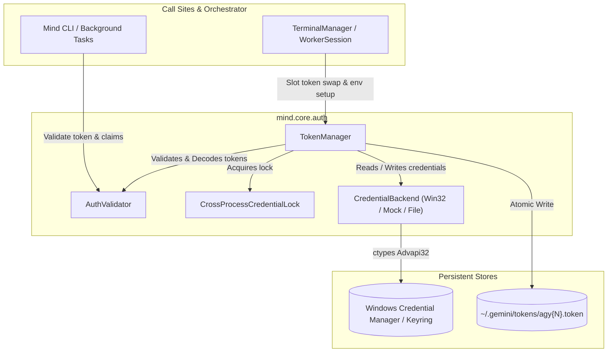

# Authentication Module Architecture & Interface Specifications

> **Status:** Draft / Proposed  
> **Target Module:** `mind.core.auth` (refactored from `mind.core.credentials`)  
> **Author:** Antigravity Pair Programmer  
> **Related Issue / Directive:** Refactor Authentication Module (Sub-task: Architecture & Interface Specifications)

---

## 1. Executive Summary & Objectives

The `mind` multi-agent orchestrator manages multiple concurrent `agy` terminal sessions, each assigned to an isolated agent slot (`agy1`, `agy2`, etc.). Currently, authentication and credential isolation are managed procedurally in [`credentials.py`](file:///C:/Users/moham/Desktop/aze/src/mind/core/credentials.py). 

While functional, the legacy architecture tightly couples:
1. Token format decoding and BOM sanitization,
2. Platform-specific Windows Credential Manager ctypes calls,
3. Cross-process mutual exclusion (`Global\AgyCredentialMutex`),
4. Slot file I/O and runtime environment injection.

### Primary Objectives of the Refactor
- **Separation of Concerns:** Split validation and token claim parsing into [`AuthValidator`](file:///C:/Users/moham/Desktop/aze/docs/auth_refactor_architecture.md#authvalidator-specification) and credential lifecycle/slot management into [`TokenManager`](file:///C:/Users/moham/Desktop/aze/docs/auth_refactor_architecture.md#tokenmanager-specification).
- **Pluggable Backends:** Abstract keyring storage via a [`CredentialBackend`](file:///C:/Users/moham/Desktop/aze/docs/auth_refactor_architecture.md#credentialbackend-protocol) interface to simplify Linux/macOS cross-platform support and unit test mocking.
- **Robust Verification:** Explicitly validate JWT expiration, integrity, and claim constraints with clear error hierarchies rather than silent `None` swallows.
- **Zero-Downtime Migration:** Provide 100% backwards-compatible procedural facades in `mind.core.credentials` ensuring no disruptions to [`TerminalManager`](file:///C:/Users/moham/Desktop/aze/src/mind/core/terminal_manager.py).

---

## 2. Architecture Overview



---

## 3. Component Specifications

### 3.1 Data Models & Protocols

```python
from __future__ import annotations
from dataclasses import dataclass, field
from datetime import datetime
from enum import Enum
from pathlib import Path
from typing import Any, Protocol, runtime_checkable

class TokenStatus(str, Enum):
    VALID = "valid"
    EXPIRED = "expired"
    MALFORMED = "malformed"
    EMPTY = "empty"

@dataclass(frozen=True)
class TokenClaims:
    """Decoded claims extracted from the token's identity payload."""
    email: str | None = None
    subject: str | None = None
    expires_at: datetime | None = None
    issued_at: datetime | None = None
    issuer: str | None = None
    raw_claims: dict[str, Any] = field(default_factory=dict)

@dataclass(frozen=True)
class ValidationResult:
    """Outcome of token inspection and validation."""
    status: TokenStatus
    claims: TokenClaims | None = None
    sanitized_bytes: bytes = b""
    error_message: str | None = None

    @property
    def is_valid(self) -> bool:
        return self.status == TokenStatus.VALID

@runtime_checkable
class CredentialBackend(Protocol):
    """Abstraction over system secret stores (Windows Credential Manager, SecretService, Keychain)."""
    def read(self, target_name: str) -> bytes | None: ...
    def write(self, target_name: str, secret: bytes, user_name: str = "antigravity") -> bool: ...
    def delete(self, target_name: str) -> bool: ...
```

---

### 3.2 `AuthValidator` Specification

The `AuthValidator` is a stateless, pure component responsible for sanitization, decoding, format detection, and claim verification.

#### Responsibilities
1. **BOM Sanitization:** Strip UTF-8 Byte Order Marks (`\xef\xbb\xbf`) from raw binary and string payloads.
2. **JSON Structure Unpacking:** Support both top-level OAuth responses and nested `{ "token": { ... } }` schemas.
3. **JWT Claims Parsing:** Extract and URL-safe base64-decode the payload segment of `id_token` or `access_token`.
4. **Temporal Verification:** Verify token expiration against UTC time with a configurable clock-skew tolerance (default: 60s).

#### Interface Definition
```python
class AuthValidator:
    """Validates, cleans, and decodes authentication tokens."""

    def __init__(self, clock_skew_seconds: int = 60) -> None:
        self.clock_skew_seconds = clock_skew_seconds

    def sanitize(self, raw_token: str | bytes) -> bytes:
        """Strip UTF-8 BOM, whitespace, and normalize to UTF-8 bytes."""
        ...

    def extract_claims(self, raw_token: str | bytes) -> TokenClaims | None:
        """Parse token payload and extract identity claims without throwing."""
        ...

    def extract_email(self, raw_token: str | bytes) -> str | None:
        """Convenience method returning the email claim if present."""
        ...

    def validate(self, raw_token: str | bytes) -> ValidationResult:
        """Full validation checking structure, parsing JWT claims, and testing expiry."""
        ...
```

---

### 3.3 `TokenManager` Specification

The `TokenManager` is a stateful lifecycle coordinator responsible for synchronizing tokens between slot files, Windows Credential Manager, and worker process runtime environments.

#### Responsibilities
1. **Cross-Process Coordination:** Orchestrate mutex locking and file locking via `CrossProcessCredentialLock` during read/write cycles.
2. **Slot Token Lifecycle:**
   - Compute token paths: `~/.gemini/tokens/agy{slot}.token`.
   - Restore slot tokens to the system credential store before worker startup.
   - Sync system credential updates (token renewals) back into slot storage.
3. **Environment Isolation:** Build sanitized environment variables (`AGY_SLOT`, `AGY_TOKEN_FILE`), stripping directory overrides that trigger OAuth login loops.
4. **Atomic Persistence:** Write token files atomically via temp files to avoid partial reads by concurrent processes.

#### Interface Definition
```python
class TokenManager:
    """Manages slot token persistence, keyring synchronization, and process environments."""

    def __init__(
        self,
        backend: CredentialBackend | None = None,
        validator: AuthValidator | None = None,
        tokens_dir: Path | None = None,
        lock_name: str = r"Global\AgyCredentialMutex",
    ) -> None:
        self.backend = backend or WindowsCredentialBackend()
        self.validator = validator or AuthValidator()
        self.tokens_dir = tokens_dir or (Path.home() / ".gemini" / "tokens")
        self.lock_name = lock_name

    def get_slot_path(self, slot: int) -> Path:
        """Return the path to the slot's token file."""
        ...

    def restore_slot(self, slot: int, target_name: str = "gemini:antigravity") -> bool:
        """Atomically read slot token, validate/sanitize it, and store into system backend under lock."""
        ...

    def sync_slot_from_system(self, slot: int, target_name: str = "gemini:antigravity") -> bool:
        """Read system keyring token under lock and update slot token file if changed."""
        ...

    def build_slot_environment(
        self,
        slot: int,
        base_env: dict[str, str] | None = None,
    ) -> dict[str, str]:
        """Construct sanitized environment variables for worker slot."""
        ...

    def write_slot_token(self, slot: int, token_bytes: bytes) -> bool:
        """Write token bytes to slot storage atomically."""
        ...
```

---

## 4. Error Handling Hierarchy

```python
class AuthError(Exception):
    """Base exception for all authentication and credential errors."""

class TokenValidationError(AuthError):
    """Raised when token is malformed, corrupted, or missing required fields."""

class TokenExpiredError(TokenValidationError):
    """Raised when token expiration timestamp has elapsed."""

class KeyringStorageError(AuthError):
    """Raised when system credential manager read/write fails."""

class LockTimeoutError(AuthError):
    """Raised when acquiring cross-process mutex or file lock times out."""
```

---

## 5. Migration Guide & Backwards Compatibility

To guarantee continuous operation without regressions, the refactoring follows a 3-phase migration plan.

### Phase 1: Implementation with Shim Facade (Zero Breaking Changes)
1. Implement the new components in `mind/core/auth/`:
   - `mind/core/auth/__init__.py`
   - `mind/core/auth/models.py`
   - `mind/core/auth/validator.py` (`AuthValidator`)
   - `mind/core/auth/manager.py` (`TokenManager`)
   - `mind/core/auth/backends.py` (`WindowsCredentialBackend`, `MockCredentialBackend`)
2. Retain [`credentials.py`](file:///C:/Users/moham/Desktop/aze/src/mind/core/credentials.py) as a backwards-compatible facade:
   ```python
   # mind/core/credentials.py
   from mind.core.auth.manager import TokenManager
   from mind.core.auth.validator import AuthValidator
   from mind.core.auth.lock import CrossProcessCredentialLock

   _default_manager = TokenManager()
   _default_validator = AuthValidator()

   def extract_email_from_token(raw_token):
       return _default_validator.extract_email(raw_token)

   def read_credential(target_name="gemini:antigravity"):
       return _default_manager.backend.read(target_name)

   def write_credential(token_bytes, target_name="gemini:antigravity", user_name="antigravity"):
       return _default_manager.backend.write(target_name, token_bytes, user_name)

   def get_slot_token_path(slot: int):
       return _default_manager.get_slot_path(slot)

   def restore_slot_credential(slot: int):
       return _default_manager.restore_slot(slot)

   def sync_slot_credential_from_system(slot: int):
       return _default_manager.sync_slot_from_system(slot)

   def setup_slot_env(slot: int, base_env=None):
       return _default_manager.build_slot_environment(slot, base_env)
   ```

### Phase 2: Refactoring Consumer Sites
- Update [`TerminalManager`](file:///C:/Users/moham/Desktop/aze/src/mind/core/terminal_manager.py) to inject a singleton or shared instance of `TokenManager`.
- Update [`tests/test_credentials_isolation.py`](file:///C:/Users/moham/Desktop/aze/tests/test_credentials_isolation.py) to test both the modular classes directly and the legacy shims.

### Phase 3: Deprecation Warning & Cleanup
- Issue a `DeprecationWarning` when calling functions from `mind.core.credentials`.
- In subsequent major release, transition all internal imports directly to `mind.core.auth`.
